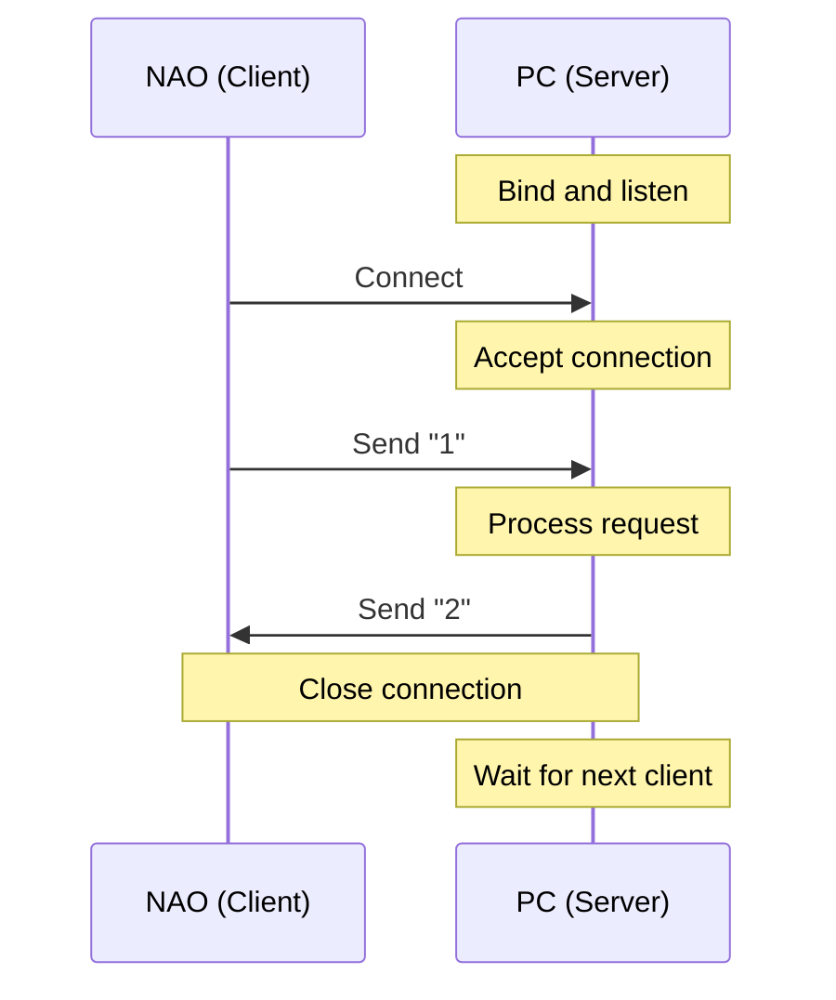
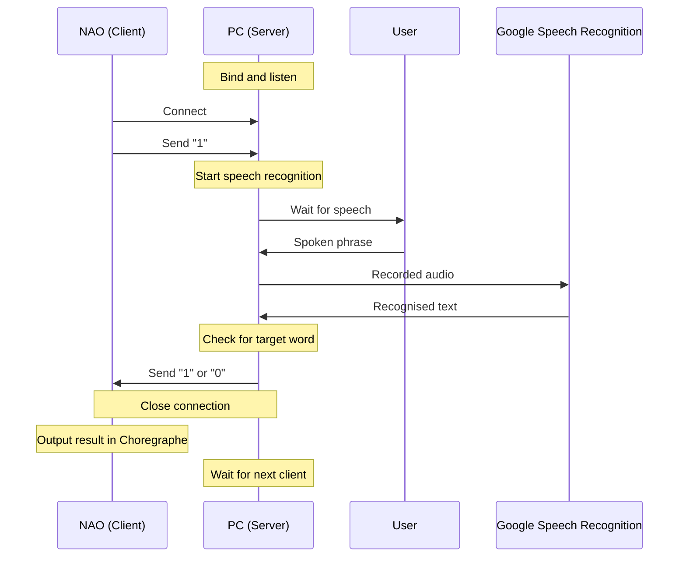

# Tutorial 7: Communication with the robot

## Part 1: Basic communication with the robot

You will learn how to send simple commands between the NAO and computer using sockets. The robot will send a message to the server, and the server will perform calculations and send back a response.

The robot code is in the file []() `ONROBOT_connect2server.py` (which you should put in a python box in Choreographe) and the server code is in the file `simple_socket_server.py`.





## Part 2: Advanced communication with the robot

You will learn how to send more complex commands. The server will now perform "complicated" calculations and send back a response to the robot.

The robot code is in the file `ONROBOT_connect2server.py` (which you should put in a python box in Choreographe) and the server code is in the file `mediapipe_socket_server.py`.




---

# Requirements

If you cannot use mediapipe on your preferred python environment, you can use the following to install it on your system:

1. Make sure you have a ***Python version between 3.8 and 3.11***.

To install Python on Windows:

- Option 1: Open a terminal, type ```Python```. This will take you to the Microsoft Store
- Option 2: Download from: https://www.python.org/downloads/windows/ , then right click, install as admin.
- Then ***Reboot***

On Linux, most distros will have it installed

2. Install ***OpenCV***
   Type `pip install opencv-python` on terminal

3. Install Media Pipe
   Type `pip install mediapipe` on terminal
